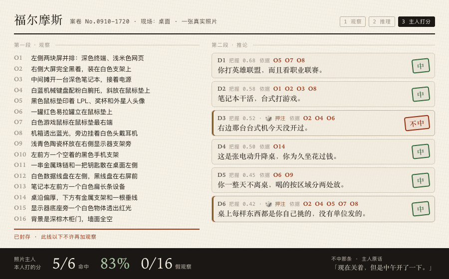
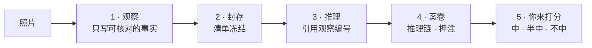

<div align="center">

# 🔍 福尔摩斯 · Holmes

**一个 agent skill，像福尔摩斯读陌生人一样读一张照片，并把推理过程摊开给你看。**

<p align="center">
  <a href="README.md"></a>
  <a href="README.zh-CN.md"></a>
</p>

<p align="center">
  <a href="LICENSE"></a>
  <a href="https://agentskills.io"></a>
  
  <a href="CONTRIBUTING.md"></a>
  <a href="https://github.com/Oldcircle/holmes-skill/stargazers"></a>
</p>

<p align="center">
  <b>适用于</b><br>
  <a href="https://code.claude.com/docs/en/skills"></a>
  <a href="https://developers.openai.com/codex/skills"></a>
  <a href="https://cursor.com/docs/skills"></a>
  <a href="https://geminicli.com/docs/cli/skills/"></a>
  <a href="https://opencode.ai/docs/skills/"></a>
  <a href="https://docs.github.com/en/copilot/concepts/agents/about-agent-skills"></a>
  <br><sub>……以及其他任何能读取 <code>SKILL.md</code>、能看图的 agent。</sub>
</p>



*一张真实的桌面照。它先写了 16 条观察，写完封存，才开始推理。6 条推论，每条都标着依据。桌子的主人逐条打分：5 条中，1 条不中，假观察 0 条。*

</div>

---

## 快速开始

```bash
npx skills add Oldcircle/holmes-skill
```

按提示勾选你用的 agent。然后丢给它一张照片，你的桌子、你的房间或者你自己都行，说一句：

> 像福尔摩斯一样推理一下

它先把看得见的东西列成清单，列完封存，才开始推理。每条结论都标出它依据哪几条观察，再给一个同样说得通的其他解释。你逐条打分：中、半中、不中。想自己复制文件夹？见[安装](#安装)。

## 为什么是福尔摩斯

- **先看，后想。** 看得见的东西全部编号写下，清单封存之后才打开痕迹库。模型如果事先知道自己在找一个跑步的人，就会看见其实不存在的跑鞋。
- **每条结论都亮出依据。** 引用观察编号，推理链最多三步，给出校准过的把握，外加一个同样说得通的其他解释。需要清单以外东西的结论，直接划掉。
- **由你打分。** 每条结论判中、半中或不中，照片里没有的观察单独标出来。最后出两个数：命中率，和更要紧的假观察率。
- **它敢下注。** 至少一条结论要把两条以上互不相关的观察串起来，还要有一到两条押注，话说死，不留余地。
- **读痕迹，不读长相。** 读人的时候只记做过的事留下的痕迹：压痕、晒痕、磨损、老茧、表戴在哪只手。五官、体型、年龄、族裔、健康，一条都不记。
- **不用 API Key，没有服务器。** 整个 skill 就是一个 Markdown 文件加一个痕迹库，看图的是你的 agent 本来就在用的模型。
- **一个 skill，所有 agent 通用。** 标准 Agent Skill，同一个文件夹在 Claude Code、Codex、Cursor、Gemini CLI、OpenCode 和 GitHub Copilot 里都能用。

## 两张真实照片

两张照片都是用这个 skill 读的，由照片主人本人逐条打分。

| 照片 | 观察 | 假观察 | 结论 | 中 | 不中 |
|---|---|---|---|---|---|
| 桌面 | 16 | 0 | 6 | 5 | 1 |
| 自拍（读人模式） | 13（其中 9 条在房间里） | 0 | 5 | 5 | 0 |

### 桌面

推理开始前，它写了 16 条观察。其中两条看着像凑数的：「一罐红色易拉罐立在鼠标垫上」，「桌面边缘偏厚，下方可见金属支架结构和一根垂下的线」。

第二条后来成了一条结论：**「这是张电动升降桌，你为久坐花过钱。」**普通桌子用不着通电。主人确认，中了。

第一条进了唯一那条不中。D3 说右边那台台式机今天没开过，给了三条依据：大屏全黑，键盘被斜推到鼠标垫上，易拉罐直接立在鼠标垫上。三条都是真的。主人的回答是：「现在关着，但是中午开了一下。」痕迹只撑得住「此刻没在用」，结论写成了「今天没开过」。这条不中后来写进了 [`SKILL.md`](skills/holmes/SKILL.md)，成了一条规则：结论在时间上不能超出痕迹撑得住的范围。

### 自拍

脸就在画面正中。13 条观察里，4 条在人身上（眼镜、耳骨上的金属饰物、华夫格上衣、胡茬），9 条在身后的房间里，没有一条描述五官。

主人没料到的是这一条：**「这个房间不是你布置的，你只是拿它当工位用。」**书柜和门框是同色系的一整套红木，装修时一次配齐；柜里是带函套的成套书、装裱的字、合影相框，是摆着看的；唯一跟这套风格不搭的家具，是主人身后那把浅蓝绿办公椅，而那把椅子正是主人自己搬进来的。

5 条结论里有 2 条单靠房间就能得出，没有一条是从五官读出来的。

<details>
<summary>完整案卷：桌面</summary>

```
案卷 No.0910-1720 · 现场：桌面 · 观察 16 条

── 观察 ──
O1  [high] 左侧两块屏幕并排，左边深色终端，右边浅米色网页 · 桌面后方
O2  [high] 右侧一块大屏完全黑着，装在白色支架上 · 桌面右后
O3  [high] 中间摊开一台深色笔记本，接着电源线 · 桌面正中
O4  [high] 白蓝双色机械键盘配粉白腕托，斜放在鼠标垫上，不正对任何屏幕 · 桌面右侧
O5  [high] 黑色鼠标垫印着 LPL 字样、奖杯图案和外星人头像 · 桌面右侧
O6  [high] 一罐红色易拉罐立在鼠标垫上，紧挨键盘右侧 · 键盘右侧
O7  [high] 白色游戏鼠标在鼠标垫最右端 · 鼠标垫右侧
O8  [high] 黑色机箱透出蓝光，一副白色头戴耳机挂在旁边 · 画面最右
O9  [high] 浅青色陶瓷杯放在右侧显示器支架旁，离键盘区有距离 · 桌面右后
O10 [med]  桌面左前方一个黑色手机支架，是空的 · 桌面左前
O11 [med]  一串金属珠链和一把钥匙散在桌面左侧 · 桌面左侧
O12 [high] 白色数据线在左侧盘成一圈，另一根黑线在右侧显示器前盘着 · 桌面左侧与中右
O13 [med]  笔记本左前方躺着一个白色扁长条设备 · 笔记本左前
O14 [med]  桌面边缘偏厚，下方可见金属支架结构和一根垂下的线 · 整张桌
O15 [med]  右侧显示器支架底座附近一个白色物体透出红光 · 显示器下方
O16 [low]  背景左侧是深棕木质柜门，其余墙面全空，没有任何挂饰 · 画面后方

── 推论 ──
D1 · 把握 0.68 · 稳                                                    中
你打英雄联盟，而且看职业联赛，不只是自己开黑。
  ① LPL 是英雄联盟的中国职业联赛，印着联赛奖杯的鼠标垫是官方周边，不是随手买的通用垫。
  ② 白色游戏鼠标、机箱灯、头戴耳机成套配齐，这套外设是为游戏配的，不是为办公配的。
  依据 O5 O7 O8 ｜ 痕迹 desk.gaming-setup
  也可能：垫子是别人送的，或者你只是喜欢这个视觉风格。

D2 · 把握 0.58 · 稳                                                    中
你把干活和打游戏拆成了两套设备，笔记本干活，台式打游戏。
  ① 笔记本摊在正中接着电源，屏上是文档，左边两块屏跟着它在工作。
  ② 右边那块大屏配的是独立机箱和整套游戏外设，和笔记本这套物理上分在桌子两端。
  依据 O1 O2 O3 O8
  也可能：台式才是主力，笔记本只是今天临时接管。

D3 · 把握 0.52 · 押注 🎲                                               不中
右边那台台式机今天没开过。
  ① 大屏是全黑，不是待机亮度。
  ② 键盘被斜推到鼠标垫上压着腕托，不对任何一块屏幕。
  ③ 饮料罐直接立在鼠标垫上，正在用鼠标的人不会把罐子放垫子上。
  依据 O2 O4 O6
  也可能：刚打完随手一放，屏幕只是睡了。
  主人：「现在关着，但是中午开了一下。」

D4 · 把握 0.50 · 稳                                                    中
这是张电动升降桌，你为久坐花过钱。
  ① 桌面边缘偏厚，下方能看到金属支架结构。
  ② 桌下垂着一根线，普通桌子不需要供电。
  依据 O14
  也可能：那只是普通桌子的走线孔。

D5 · 把握 0.45 · 稳                                                    中
你一整天不离桌，喝的东西按区域分两处放。
  ① 桌上同时有一罐饮料和一个陶瓷杯，且不在一处：罐子在游戏区，杯子在显示器区。
  ② 两个都没收走。
  依据 O6 O9 ｜ 痕迹 desk.multi-cups
  也可能：杯子是别人的，或者只是没顺手收。

D6 · 把握 0.42 · 押注 🎲                                               中
这桌上每件东西都是你自己挑的，没有一件是单位发的。
  ① 键盘是白蓝配色带独立腕托，鼠标垫是联赛周边，耳机和鼠标是同一套白色系。
  ② 显示器上了支架，机箱带灯，这些都要额外花钱和花时间才会有。
  依据 O2 O4 O5 O7 O8
  也可能：其中一部分是团队福利或活动赠品。

── 结案陈词 ──
你左边那块屏上正开着我。哪条错了，正好拿去点「不中」。
```

</details>

<details>
<summary>完整案卷：自拍</summary>

```
案卷 No.0910-1740 · 现场：人 · 观察 13 条

── 观察 ──
O1  [high] 戴细边眼镜，上缘颜色较深，鼻托与镜腿是金属的 · 人物
O2  [med]  一侧耳廓上有金属饰物，像耳骨夹或成组耳钉 · 人物
O3  [high] 深灰黑色短袖上衣，圆领带纽扣门襟，面料是华夫格纹理 · 人物
O4  [med]  下颌与下巴有稀疏短胡茬，边界不齐 · 人物
O5  [high] 背景整面深红棕木质玻璃门书柜，中式风格 · 画面后方
O6  [high] 柜内成排书籍，含多套带函套的成套书 · 书柜内
O7  [high] 柜内摆着数个相框，其中一个是多人合影 · 书柜内
O8  [med]  书柜上层立着白底竖排字的卡片或装裱件 · 书柜上层
O9  [high] 书柜前一把浅蓝绿色办公椅，椅背朝外 · 人物身后
O10 [high] 右侧门框是同色系深红棕木，墙面纯白无任何挂饰 · 画面右侧
O11 [med]  天花板为白色阶梯式吊顶 · 画面上方
O12 [med]  右墙一个白色开关面板 · 画面右侧
O13 [low]  右下角有桌面边缘，上面一个深色物体和一个瓶状物 · 画面右下

── 推论 ──
D1 · 把握 0.55 · 稳                                                    中
这个房间不是你布置的，你只是拿它当工位用。
  ① 书柜和门框是同色系成套红木，是整屋装修时一次配齐的，不是后来单买的。
  ② 柜里是带函套的成套书、装裱的字、合影相框，这是陈列，不是在用的书架。
  ③ 唯一一件跟这套风格不搭的家具，是你身后那把浅蓝绿办公椅，它是后加进来的。
  依据 O5 O6 O7 O8 O9 O10
  也可能：这就是你自己的书房，只是你偏好传统风格。

D2 · 把握 0.50 · 稳                                                    中
你在这儿是久坐干活，不是来看书的。
  ① 你把一把功能性办公椅搬进了一个陈列型书房。
  ② 拍照时你坐着，取景随意，穿的是家常短袖。
  依据 O3 O9
  也可能：只是临时在这儿待一会儿。

D3 · 把握 0.45 · 押注 🎲                                               中
这套房子的装修有年头了，不是近几年的新房。
  ① 成套红木柜配同色门框，加阶梯式石膏吊顶，是一个特定年代的住宅装修组合。
  ② 墙面完全空白，没有后期加装的挂画或置物。
  依据 O5 O10 O11
  也可能：新房刻意做的仿古装修。

D4 · 把握 0.42 · 押注 🎲                                               中
你的审美跟这个房间不是一路的。
  ① 耳廓上戴着金属饰物，上衣是华夫格门襟款。
  ② 这两样都是你自己选的，房间不是。
  依据 O2 O3 O5
  也可能：耳饰只是随手戴的，衣服只是顺手抓的。

D5 · 把握 0.40 · 稳                                                    中
你眼镜是常年戴，不是偶尔戴。
  ① 镜框选的是细边金属款。常年架在鼻梁上的人才会在意重量，偶尔戴的不挑这个。
  依据 O1
  也可能：纯粹喜欢这个款式。

── 结案陈词 ──
我一条都没从你脸上读。哪条错了？
```

</details>

## 安装

福尔摩斯是一个标准的 [Agent Skill](https://agentskills.io)：一个文件夹，里面是 `SKILL.md` 和 `references/`。没有脚本要跑，也没有东西要配置。可以用 [`skills`](https://github.com/vercel-labs/skills) 命令行工具装，也可以自己复制文件夹。

**六个 agent 一起装，用户级，一条命令：**

```bash
npx skills add Oldcircle/holmes-skill -g -y \
  -a claude-code -a codex -a cursor -a gemini-cli -a opencode -a github-copilot
```

**只装 Claude Code，手动：**

```bash
git clone https://github.com/Oldcircle/holmes-skill.git
cp -r holmes-skill/skills/holmes ~/.claude/skills/
```

**所有 agent，手动：**

```bash
git clone https://github.com/Oldcircle/holmes-skill.git
mkdir -p ~/.agents/skills ~/.claude/skills
# Codex、Cursor、Gemini CLI、OpenCode、GitHub Copilot
cp -r holmes-skill/skills/holmes ~/.agents/skills/
# Claude Code
ln -s ~/.agents/skills/holmes ~/.claude/skills/holmes
```

`~/.agents/skills/` 会被 Codex、Cursor、Gemini CLI、OpenCode 和 GitHub Copilot 读取，放一份就覆盖这五个。各 agent 自己的目录（出自各家文档）：

| Agent | 用户级 | 项目级 |
|---|---|---|
| [Claude Code](https://code.claude.com/docs/en/skills) | `~/.claude/skills/` | `.claude/skills/` |
| [Codex](https://developers.openai.com/codex/skills) | `~/.agents/skills/` | `.agents/skills/` |
| [Cursor](https://cursor.com/docs/skills) | `~/.cursor/skills/` 或 `~/.agents/skills/` | `.cursor/skills/` 或 `.agents/skills/` |
| [Gemini CLI](https://geminicli.com/docs/cli/skills/) | `~/.gemini/skills/` 或 `~/.agents/skills/` | `.gemini/skills/` 或 `.agents/skills/` |
| [OpenCode](https://opencode.ai/docs/skills/) | `~/.config/opencode/skills/` 或 `~/.agents/skills/` | `.opencode/skills/` 或 `.agents/skills/` |
| [GitHub Copilot](https://docs.github.com/en/copilot/concepts/agents/about-agent-skills) | `~/.copilot/skills/` 或 `~/.agents/skills/` | `.github/skills/` 或 `.agents/skills/` |

唯一的要求是模型能看图。如果 agent 手里只有一个文件路径，skill 会让它先打开图片；看不到图就停下，不去描述一张没看过的照片。

在 Claude Code 里也可以直接输入 `/holmes` 调用。可以这样试：

> 像福尔摩斯一样推理一下这张照片

> 拍了张我的桌面，读读我的桌子

> 这是我包里的东西，你能看出什么？

## 它是怎么工作的



完整的方法都在 [`skills/holmes/SKILL.md`](skills/holmes/SKILL.md) 里。它的几条规矩，和各自的理由：

| 规矩 | 为什么 |
|---|---|
| 观察清单写完、封存之后，才打开痕迹库 | 模型如果事先知道自己在找什么，不管那东西在不在，它都容易看见。 |
| 每条观察都得是照片主人能指着照片确认的 | 「程序员的桌子」是结论；「键帽只有 WASD 磨亮」才算观察。 |
| 每条结论都要引用观察编号，需要清单以外东西的结论直接划掉 | 这样「看错了」和「想错了」能分开算。 |
| 至少一条结论要串起两条以上互不相关的观察 | 单独一条痕迹可能只是巧合。华生晒黑的脸、僵硬的左臂、军人的站姿、医生的举止，单看哪一条都说明不了什么。 |
| 要有一到两条押注 | 一份不可能错的解读，也就没什么可看的。 |
| 结论在时间上不能超出痕迹撑得住的范围 | 这条来自上面桌面案卷里唯一那条不中。 |
| 每条结论都要给一个其他解释 | 主人可以拿它和结论对照着判。 |

**每份打过分的案卷都会出两个数：**

- **命中率** = (中 + 0.5 × 半中) ÷ 已打分的结论数
- **假观察率** = 被标「没这东西」的观察 ÷ 观察总数

第二个数更要紧。从真实的痕迹推错了，是一次诚实的失手，主人一句话就能纠正。观察本身是编的，引用它的结论就全都不算数。

## 痕迹库

98 条，中英双语：读物 44 条，读人 56 条（包类痕迹两边都算）。每条是「痕迹 → 可能成因」，每个成因带一个权重，有些还附了一句什么时候容易看走眼。举几条，摘自 [`references/`](skills/holmes/references)：

| 痕迹 | 看到什么 | 可能的成因 |
|---|---|---|
| `desk.keyboard-shine` | 键帽油光或磨损集中在某些键 | WASD 与空格油光：长期打游戏（强）；字母区整体油光：重度打字（中）；小键盘区磨损：财务、数据录入（中） |
| `desk.dust-gradient` | 有的设备干净、周边积灰 | 干净的是每天用的，积灰的是买了不用的（强） |
| `clothing.rolled-one-trouser-leg` | 只卷起右边（或链条侧）一条裤腿 | 骑自行车通勤，防裤腿卷进链条（强） |
| `hands.ring-mark-no-ring` | 无名指根部有一圈浅色压痕/晒痕，但没戴戒指 | 长期戴戒指，最近才摘下（强）；工作要求摘首饰（中） |
| `accessories.pawn-scratches` | 怀表壳内侧刻着几组细小的当票号码 | 这块表被反复典当又赎回（强）。出自《四签名》 |

痕迹库是给模型参考的，模型可以在它之外推理；只有真对得上的时候，结论才引用某条痕迹。加一条痕迹是最容易上手的贡献方式，见[参与贡献](#参与贡献)。

## 网页版

不想用 agent 的话，还有一个网页版：纯静态页面，没有后端，自己填一个能看图的模型的 Key（Anthropic、Gemini，或者任何 OpenAI 兼容端点，比如 Qwen-VL、GLM、OpenRouter）。Key 只存在你浏览器的 localStorage 里，照片从你的浏览器直接发给你选的服务商。

```bash
pnpm install
pnpm dev          # http://localhost:5173
```

打开 `?demo=1`（读物）或 `?demo=person`（读人）可以直接看一份做好的案卷，不调用任何模型。`?replay=1` 会把上面那份桌面案卷从观察一路演到分享卡。

网页版把两段拆成两次独立的模型调用。推理那次调用拿不到照片，只拿得到观察清单和痕迹库，所以「看错了什么」和「想错了什么」可以分开计量。

它还会检查模型到底有没有看到图。观察那次调用必须先报出照片是横是竖、主色是什么，再和真实文件比对，同时卡一个输入 token 下限。对不上就把这份案卷标成可疑，并禁掉分享。这个检查来自一次真实的翻车：某家服务商的 OpenAI 兼容端点收下了带图片的请求，不报错，把图片悄悄丢了，然后描述了一张根本不存在的桌子，14 条观察全是编的。当场被这个检查抓住。

<details>
<summary>开发命令</summary>

```bash
pnpm test           # 痕迹库 schema、安全守卫、生成物是否同步、prompt
pnpm typecheck
pnpm build
pnpm build:skill    # src/traces/*.ts → skills/holmes/references/*.md
pnpm probe --dir photos --lang zh    # 跑一批照片，出打分表
pnpm smoke                           # 只跑推理段，不看图
```

Node 访问服务商需要代理时：`NODE_USE_ENV_PROXY=1 HTTPS_PROXY=http://127.0.0.1:<端口> pnpm probe …`

</details>

## 它不做的事

永不推断：健康、疾病、用药、残障、怀孕、心理状态、民族或种族、宗教、性取向、政治立场、移民身份、精确收入。画面里如果有药瓶或宗教物品，它会直接不写进清单。

读人的时候还额外不做：不从五官推性格或命运，不说这个人是谁、在哪上班，不评价长相、胖瘦和身材，不说精确年龄。

只有照片是本人的、或者本人同意了，它才读人。给它一张偷拍的陌生人、别人社交主页的截图、公众人物的照片，它会拒绝。请只拿它读你自己的照片。跟踪、查岗、背调，都不行。

## 不只是照片

真正有用的是这个顺序，它不只适用于照片。读合同、读体检报告、理一大段聊天记录都一样：先让模型把事实编号列完，停一下，再让它下结论，每条结论写清楚是从哪几条事实来的。这样每条结论都得指向一个真实存在的东西。

## 路线图

- [ ] 加第四档打分「换谁都成立」，和「中」分开计；再加一条规则：结论换到大多数人身上应该不成立
- [ ] 一份公开的打分案卷集，覆盖更多照片、更多人
- [ ] 更多中国大陆以外地区的痕迹和基础率
- [ ] 用更多视觉模型跑网页版，公开结果

## 参与贡献

欢迎 issue 和 PR，见 [CONTRIBUTING.md](CONTRIBUTING.md)。最有用的两种贡献：加一条痕迹；或者提一份读错了的案卷，并指出第一处出错的地方。

## Star History

<a href="https://star-history.com/#Oldcircle/holmes-skill&Date">
  
</a>

## 致谢

Arthur Conan Doyle，以及他的老师 Joseph Bell：那位在爱丁堡靠病人的手和口音说出对方职业的外科医生。

## 许可证

MIT，见 [LICENSE](LICENSE)。

<sub>**负责任地使用：**读你自己的照片，或者本人同意被读的照片。</sub>
